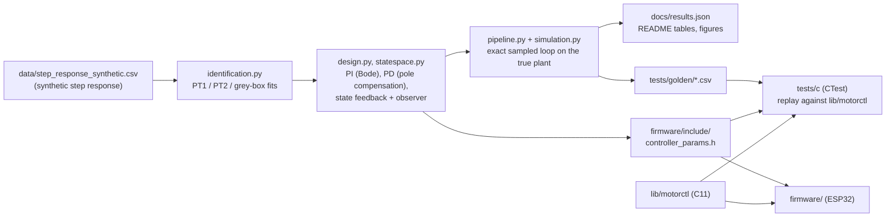
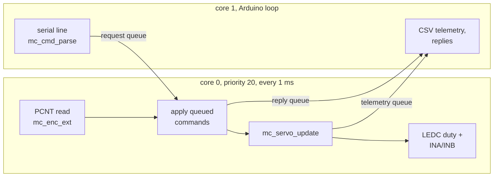
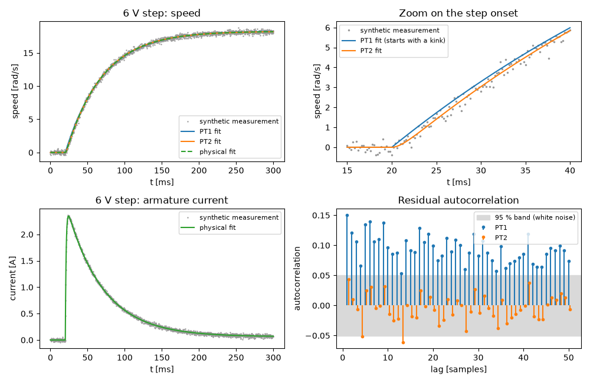
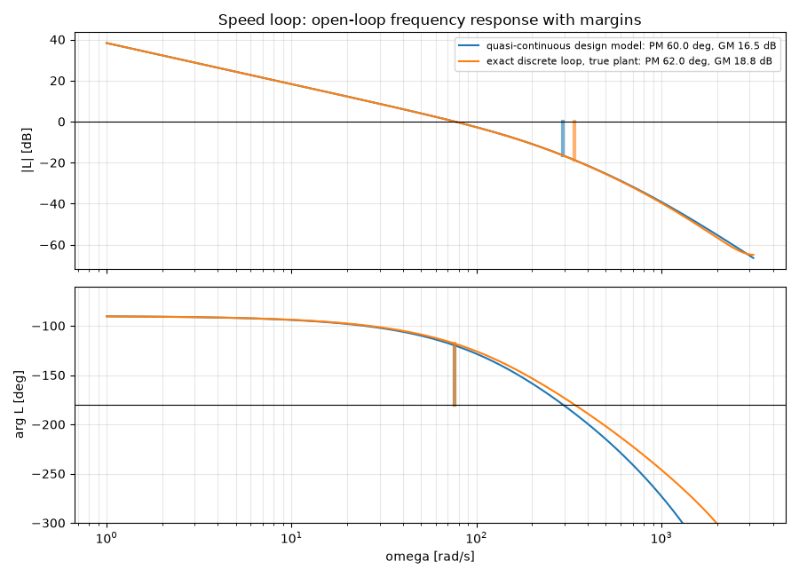
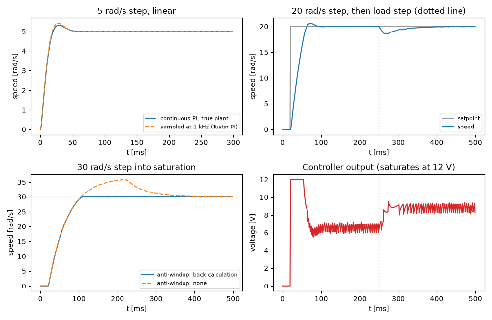
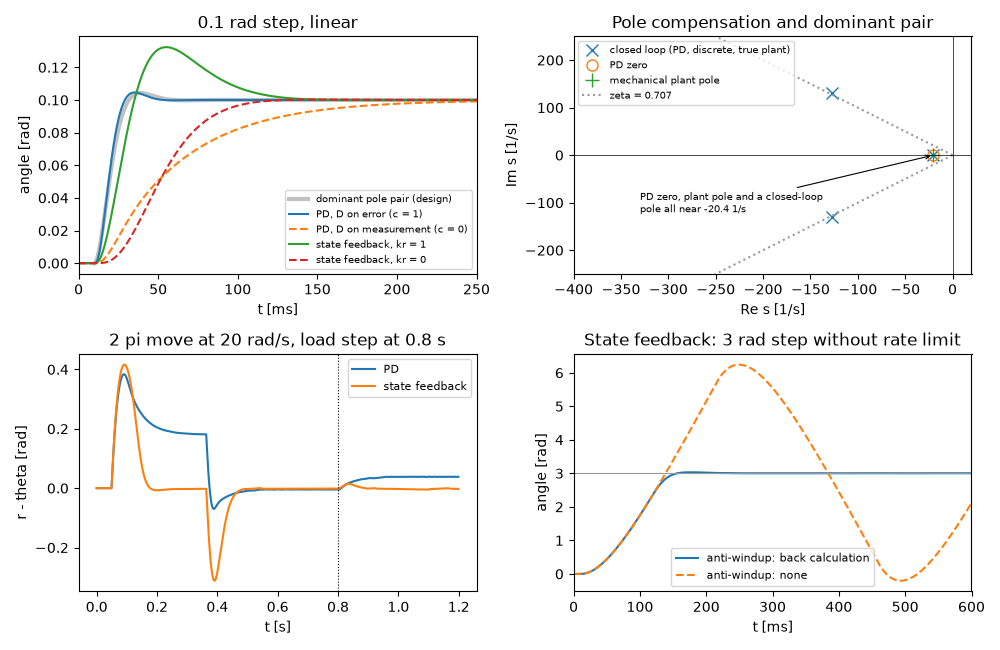
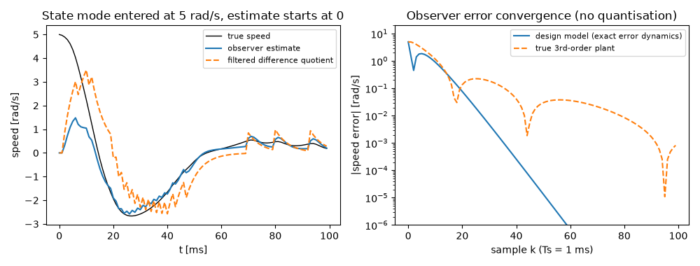
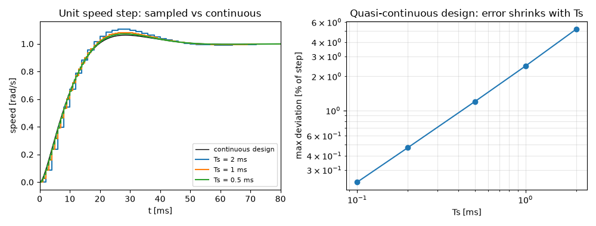

# dc-motor-control

DC-motor speed and position control end to end: first-principles model, parameter identification, frequency-response and pole-placement design, discretisation, a portable C11 controller library with golden-vector tests, and ESP32 firmware.


Everything here is verified in simulation. The firmware compiles for the ESP32; it has not yet been tested on hardware. The "measured" step response used for identification is synthetic data generated from known parameters, so the identified values can be compared with the truth.

## Context

This is a self-directed project applying the content of the modules **Regelungstechnik** (Control Systems Design, B25), **Aktorik und Sensorik** (Actuators and Sensors, B31) and **Systemtheorie** (Systems Theory, B19) of the B.Eng. Technische Informatik – Embedded Systems at BHT Berlin. It follows the path of the B31 lab (identify a DC motor, model it, design controllers, implement them on a microcontroller) and uses the B25 and B19 methods along the way, with Python/numpy/scipy in place of Matlab/Simulink.

| Module topic | Where it appears |
|---|---|
| B19: continuous LTI models: state space, s-transfer function, Bode diagram, block diagrams | [`control/motor.py`](control/motor.py), [`control/lti.py`](control/lti.py), Bode plot below |
| B19: discrete-time systems: sampling, discrete state space, difference equations, z-transfer functions, discretisation transformations | [`control/lti.py`](control/lti.py) (`c2d_zoh`, `ss2zpoly`), [`control/discrete.py`](control/discrete.py), [`lib/motorctl`](lib/motorctl) |
| B19: energy, power and correlation of signals | sample autocorrelation of the fit residuals (whiteness test) in [`control/identification.py`](control/identification.py); steady-state power balance in [`tests/python/test_model.py`](tests/python/test_model.py) |
| B31: modelling an electromagnetic actuator from physical principles | [`control/motor.py`](control/motor.py) |
| B31: transfer functions for angular velocity and angle | `MotorParams.tf_speed`, `MotorParams.tf_angle` |
| B31: sensors: incremental encoder, quantisation, speed from position | [`mc_encoder.c`](lib/motorctl/src/mc_encoder.c), [`quad_encoder.cpp`](firmware/src/quad_encoder.cpp), speed estimate in [`mc_servo.c`](lib/motorctl/src/mc_servo.c) |
| B31 lab: parameter identification on a DC motor | [`control/identification.py`](control/identification.py) (PT1, PT2 and grey-box fits) |
| B31: state-space controller and observer | [`control/statespace.py`](control/statespace.py) (Ackermann), [`mc_ssc.c`](lib/motorctl/src/mc_ssc.c) |
| B31 lab: controller implementation on a microcontroller | [`firmware/`](firmware) (ESP32, FreeRTOS) |
| B25: control-loop structure; reference, disturbance and actuating behaviour; control error | `verify_*` in [`control/pipeline.py`](control/pipeline.py): setpoint steps, load-torque steps, saturation |
| B25: P, PI, PD, PID controllers | [`control/design.py`](control/design.py), [`mc_pid.c`](lib/motorctl/src/mc_pid.c) |
| B25: controller design with frequency-response (Bode) methods | `speed_pi_bode` in [`control/design.py`](control/design.py) |
| B25: controller design with pole compensation; dominant pole pair | `position_pd_compensation` in [`control/design.py`](control/design.py) |
| B25: simplified Nyquist criterion | `margins` in [`control/lti.py`](control/lti.py), cross-checked against closed-loop poles |
| B25: discrete-time controllers by quasi-continuous design | `verify_discretisation` in [`control/pipeline.py`](control/pipeline.py) |
| B25: verifying a design against quality criteria in simulation | [`control/simulation.py`](control/simulation.py), `step_metrics`, [`tests/python`](tests/python) |

## Features

- **Model**: permanent-magnet DC motor (R, L, K, J, b) derived from Kirchhoff's voltage law and Newton's law for rotation; state space with voltage and load torque as inputs; transfer functions for angle, speed, current and load-to-speed.
- **Identification**: PT1 and PT2 black-box fits and a five-parameter grey-box fit (speed and current) by nonlinear least squares, with 95 % confidence intervals and a residual-whiteness test. Analytic Jacobians and a Gauss-Newton polish make the result reproducible to about 1e-15.
- **Speed PI** designed in the Bode diagram for a phase-margin target; **position PD** by pole compensation with the gain set from the dominant pole pair; **state feedback with integral action** by Ackermann's formula and a **Luenberger observer** that estimates the speed from the encoder angle.
- **Margins computed from the frequency response** (no control toolbox): gain and phase margin, lower gain margin of conditionally stable loops, delay margin; checked against the roots of the closed-loop characteristic polynomial.
- **Discretisation**: ZOH for the plant, Tustin for the controllers; the sampled loop is compared with the continuous design for Ts from 0.1 to 2 ms, and Tustin with forward and backward Euler.
- **`lib/motorctl`** (portable C11, float, no heap, no globals): two-degree-of-freedom PID with Tustin integrator, filtered derivative on the measurement or the error, output limits, back-calculation anti-windup and bumpless gain changes and hand-over; state controller with observer; setpoint rate limiter; 16-to-32-bit encoder extension; text command parser; a servo module that ties them together with five modes (off, voltage, speed, position, state).
- **Golden-vector tests**: the Python reference implementation runs closed-loop scenarios on the true plant and writes CSV files; the C library replays them sample by sample (6 CTest programs).
- **ESP32 firmware** (PlatformIO, Arduino core): LEDC PWM to an H-bridge, quadrature decoding on the PCNT peripheral, a 1 kHz control task with `xTaskDelayUntil`, serial command interface and CSV telemetry, bridge fault handling, a fail-safe switch-off on non-finite controller output, timing statistics.
- **Reproducible artefacts**: one script regenerates `docs/results.json`, the result tables below, the firmware gain header, the golden vectors and the figures; the test suite fails if any committed artefact is stale.

## Architecture



Controllers are designed on the identified model and verified on the "true" plant (the parameters that generated the synthetic data, including the armature inductance that the state-space design model leaves out), so the identification error is part of every verification result.

The firmware splits the work between two FreeRTOS tasks so that serial output can never delay a control period:



## Results

The figures and every number in this section come from one run of `scripts/run_pipeline.py`.



The PT1 fit leaves correlated residuals (bottom right) because it ignores the electrical pole; the PT2 structure is exact for this plant and its residuals are white.





The ripple in the controller output (bottom right) comes from the encoder quantisation: one count per sample is a speed step of 4.76 rad/s before the 5 ms low-pass.







<!-- BEGIN GENERATED RESULTS (scripts/run_pipeline.py) -->
All values below are copied from `docs/results.json` by `scripts/run_pipeline.py`.
The plant data are synthetic and every result comes from simulation.

**Identification** (synthetic 6.0 V step, 1501 samples; true parameters known because the data are synthetic)

| Model | Parameter | True | Identified (95 % CI) | Error |
|---|---|---|---|---|
| PT2 | Ks [rad/(V s)] | 3.046 | 3.043 +- 0.0031 | -0.11 % |
| PT2 | T1 [ms] | 49.19 | 49.04 +- 0.28 | -0.29 % |
| PT2 | T2 [ms] | 1.107 | 1.073 +- 0.15 | -3.1 % |
| physical | R [ohm] | 2.400 | 2.398 +- 0.0043 | -0.064 % |
| physical | L [mH] | 2.600 | 2.618 +- 0.035 | 0.71 % |
| physical | K [V s/rad] | 0.3200 | 0.3203 +- 0.00029 | 0.096 % |
| physical | J [kg m^2] | 0.002200 | 0.002199 +- 0.0000056 | -0.045 % |
| physical | b [N m s/rad] | 0.001100 | 0.001107 +- 0.000028 | 0.65 % |

Residual whiteness (share of autocorrelation lags 1-50 inside the 95 % band): PT1 0 %, PT2 96 %, physical 96 %. The PT1 model is structurally too simple; its residuals are coloured.

**Speed PI** (Bode design, phase-margin target 60 deg)

| Quantity | Value |
|---|---|
| Kp, Ki | 1.32 V s/rad, 27.0 V/rad |
| Phase margin: quasi-continuous design / exact discrete loop, true plant | 60.0 deg / 62.0 deg |
| Gain margin (exact discrete loop, true plant) | 18.8 dB at 339 rad/s |
| Closed-loop spectral radius at 0.98 x / 1.02 x gain margin | 0.99855 / 1.0014 |
| 5 rad/s step, linear: overshoot continuous / sampled | 6.3 % / 8.2 % |
| 20 rad/s step with saturation and quantisation: overshoot, 2 % settling | 3.1 %, 61.0 ms |
| 0.30 N m load step: speed drop, recovery into 2 % band | 1.37 rad/s, 80.0 ms |
| 30 rad/s step into saturation: overshoot with / without back-calculation | 0.45 % / 20 % |
| Same step: 2 % settling time with / without back-calculation | 83.0 ms / 311 ms |

**Position PD** (pole compensation, dominant pair with zeta = 0.707)

| Quantity | Value |
|---|---|
| Kp, Kd, Tf | 35.9 V/rad, 1.65 V s/rad, 3.00 ms |
| PD zero / true plant pole / closed-loop real pole near it | -20.39 / -20.33 / -20.40 rad/s |
| Dominant pair: designed w0, zeta / actual (discrete, true plant) | 155 rad/s, 0.707 / 183 rad/s, 0.698 |
| Phase margin, gain margin (discrete, true plant) | 63.2 deg, 17.0 dB |
| 0.1 rad step overshoot: predicted by pole pair / simulated | 4.3 % / 4.6 % |
| 0.1 rad step rise time: D on error / D on measurement | 12.0 ms / 107 ms |
| 2 pi move at 20 rad/s: following error predicted / simulated | 0.183 rad / 0.185 rad |
| 0.2 N m load while holding: error predicted / simulated | 0.0417 rad / 0.0417 rad |

**State feedback + observer** (Ackermann, integral action)

| Quantity | Value |
|---|---|
| k, ki, observer gain l | [148, 2.16], 3340, [0.542, 68.4] |
| Placed poles / separation principle: max eigenvalue error | 1.4e-13 / 1.6e-13 |
| Spectral radius: design / true third-order plant | 0.9531 / 0.9547 |
| Loop broken at plant input: phase margin, upper / lower gain margin | 36.0 deg, 10.1 dB / -31.3 dB |
| Observer speed error below 5 %: design model / true plant | 16.0 ms / 15.0 ms |
| 0.1 rad step overshoot: kr = 0 / kr = 1 | 0.26 % / 32 % |
| 2 pi move, following error: kr = 0 (predicted v k0/ki) / kr = 1 | 0.887 rad (0.887) / -0.00023 rad |
| 0.2 N m load while holding, steady-state error with quantisation | -0.0026 rad |
| 3 rad step into saturation: overshoot with / without back-calculation | 1.0 % / 108 % |

**Discretisation** (quasi-continuous design check)

| Ts | Max deviation of sampled speed step from continuous design |
|---|---|
| 2.00 ms | 5.2 % |
| 1.00 ms | 2.5 % |
| 0.500 ms | 1.2 % |
| 0.200 ms | 0.47 % |
| 0.100 ms | 0.23 % |

ZOH-equivalent plant vs continuous plant at the speed crossover (76.5 rad/s): phase lag 2.191 deg, the Ts/2 dead-time model predicts 2.191 deg.

| Position PD discretised with | Controller phase error at crossover | Phase margin (true plant) |
|---|---|---|
| tustin | -0.0048 deg | 63.2 deg |
| backward euler | -2.6 deg | 60.8 deg |
| forward euler | 2.6 deg | 65.7 deg |

<!-- END GENERATED RESULTS -->

## Build & test

Linux (the CI runs exactly these steps on `ubuntu-latest`):

```sh
# Python: model, identification, design, verification (pinned versions)
python3 -m venv .venv && . .venv/bin/activate
pip install -r requirements.txt
python -m pytest                          # 69 tests, includes the staleness check below
python scripts/run_pipeline.py --check    # are results, README, header, golden vectors current?
python scripts/run_pipeline.py            # regenerate them and the figures

# C library and golden-vector replay
cmake -S . -B build -DMOTORCTL_WERROR=ON
cmake --build build
ctest --test-dir build --output-on-failure

# the same with AddressSanitizer + UndefinedBehaviorSanitizer
cmake -S . -B build-san -DMOTORCTL_WERROR=ON -DMOTORCTL_SANITIZE=ON
cmake --build build-san && ctest --test-dir build-san --output-on-failure

# ESP32 firmware
pip install platformio
pio run -d firmware                       # build
pio run -d firmware -t upload             # flash (not yet tested on hardware)
pio device monitor -d firmware            # 921600 baud
```

Windows: the same commands work in PowerShell or Git Bash; activate the virtual environment with `.venv\Scripts\activate`. CMake needs a C11 compiler and a generator such as Ninja (`-G Ninja`); no `make` is required. The library is developed with `zig cc` (clang) on Windows and built with gcc in CI.

`scripts/make_dataset.py` rewrites the synthetic dataset; it is deterministic (fixed seed), so running it does not change the committed file.

## Firmware

`pio run -d firmware` builds for `esp32dev` against the pinned PlatformIO platform `espressif32 @ 7.1.3` (Arduino core 2.0.17, ESP-IDF 4.4.7). The controller gains come from [`firmware/include/controller_params.h`](firmware/include/controller_params.h), which the pipeline generates and the C tests include as well, so the replayed golden vectors exercise exactly the configuration that is flashed.

### Wiring

The modelled motor draws 12 V / 2.4 ohm = 5 A at standstill, so the power stage is a VNH5019 carrier (PWM + INA/INB interface). A TB6612FNG has the same three-wire interface but is rated 3.2 A peak and would only suit a smaller motor.

| ESP32 (esp32dev) | Connects to | Purpose |
|---|---|---|
| GPIO25 | VNH5019 PWM | 20 kHz PWM, 11-bit duty (LEDC) |
| GPIO26 | VNH5019 INA | direction |
| GPIO27 | VNH5019 INB | direction |
| GPIO33 | VNH5019 ENA/DIAGA and ENB/DIAGB | fault input (low = fault), pulled up on the carrier |
| GPIO18 | encoder channel A | PCNT pulse/control input |
| GPIO19 | encoder channel B | PCNT pulse/control input |
| 3V3 | VNH5019 VDD, encoder supply | 3.3 V logic levels |
| GND | VNH5019 GND, encoder GND, supply GND | common ground |
| - | VNH5019 VIN = 12 V supply, OUTA/OUTB = motor | power |

The encoder resolution assumed throughout is 1320 counts per output revolution after x4 decoding. The encoder must work from 3.3 V or have open-collector outputs pulled up to 3.3 V; many gearmotor Hall encoders need at least 3.5 V supply, and a 5 V push-pull encoder needs level shifting because the ESP32 inputs are not 5 V tolerant. None of the GPIOs used is a boot-strapping pin, so the wiring cannot change the ESP32 boot mode.

### Serial interface

One command per line, 921600 baud:

| Command | Effect |
|---|---|
| `mode off\|volt\|speed\|pos\|state` | switch controller; closed-loop modes take over the current speed or angle without a jump |
| `sp <value>` | setpoint in V, rad/s or rad depending on the mode |
| `gains speed\|pos <kp> <ki> <kd>` | change PID gains without a jump in the output |
| `slew speed\|pos <rate>` | setpoint rate limit (rad/s^2 or rad/s), 0 = off |
| `tele <n>` | CSV telemetry `k,mode,r,theta,omega,omega_hat,u` every n-th sample, 0 = off |
| `status` | mode, setpoint, gains, fault flag, non-finite-output trips, overruns, worst execution time and period jitter |
| `help` | list of commands |

Telemetry rows are plain CSV; every other output line starts with `#`. `mode volt` with `tele 1` records an open-loop voltage step for identification (see the next steps below).

## Project layout

```
control/                Python package (numpy, scipy, matplotlib only)
  motor.py              first-principles DC-motor model
  lti.py                transfer functions, ZOH, simulation, margins
  identification.py     synthetic step data, PT1/PT2/grey-box fits
  design.py             Bode PI, pole-compensation PD, step metrics
  statespace.py         Ackermann, observer gain, separation-principle check
  discrete.py           float64 reference of every C module (PID, filters, state controller)
  servo.py              reference of the firmware servo module
  simulation.py         sampled closed loop on the true plant
  pipeline.py           identification -> design -> verification
  golden.py, report.py, artifacts.py, plots.py   generated files
scripts/
  run_pipeline.py       regenerate (or --check) all derived files
  make_dataset.py       write the synthetic dataset
data/                   synthetic step response (CSV, labelled as such)
docs/                   results.json and figures
lib/motorctl/           portable C11 controller library (also a PlatformIO library)
tests/python/           pytest suite
tests/c/                CTest programs, golden-vector reader
tests/golden/           golden vectors written by the pipeline
firmware/               PlatformIO project for the ESP32
CMakeLists.txt          host build of the library and the C tests
```

## Design notes

- **Design on the identified model, verify on the true plant.** The speed PI and position PD use the identified PT2 model, the state controller the identified PT1 model plus the angle integrator. Every margin, pole and time response is then computed for the exact third-order plant in the exact sampled loop (ZOH plant, the controller's own difference equations, the speed filter and the encoder quantisation where stated).
- **Speed PI in the Bode diagram.** The PI zero is placed on the dominant (mechanical) pole, which removes the slow pole from the reference response. With the zero fixed, the open-loop phase no longer depends on Kp, so the crossover is where the phase equals -180 deg + PM and Kp follows from |L| = 1. The quasi-continuous model includes the 5 ms speed filter and one sample of dead time (half a sample for the ZOH, half for the backward-difference speed estimate).
- **Position PD by pole compensation.** The PD zero cancels the mechanical pole; what remains is approximately Kp Ks / (s (T_sigma s + 1)), whose damping is set directly by Kp. Lumping the small lags (T2, the derivative filter and half a sample) into one time constant predicts the damping of the actual dominant pair almost exactly but underestimates its natural frequency, which is why the table lists both. The cancelled pole stays in the closed loop, right on the PD zero: invisible to setpoint changes, but it sets the slow tail of the load-disturbance response. With the derivative on the measurement (c = 0) the compensation no longer applies to the reference and the rise time grows by almost an order of magnitude, so the firmware uses the derivative on the error together with the setpoint rate limiter, which removes the derivative kick.
- **State feedback with a two-state design model.** The current is not measured and the electrical pole (1/T2, about 900 rad/s) is fifteen times faster than the controller poles (60 rad/s), so the design model is the PT1 speed channel plus the integrator. The observer reconstructs the speed from the quantised angle, and its estimate is better than the filtered difference quotient (a pytest test checks this). Robustness against the neglected inductance is checked on the third-order plant: the closed loop stays stable, but the margins at the plant input are moderate and the loop is conditionally stable (a lower gain margin exists), which is typical for integral state feedback.
- **Reference weight kr.** With kr = 0 the reference enters only through the integrator: no overshoot, but a ramp lags by v k0/ki. kr = 1 removes that lag at the price of a large overshoot on raw steps, which the setpoint rate limiter avoids in practice. Both variants are simulated.
- **Margins computed directly.** `lti.margins` unwraps the phase on a log grid, refines every crossing with Brent's method and reports the upper and lower gain margins. Because a numerical routine like this is easy to get subtly wrong, it is tested against loops with analytic margins and against closed-loop roots at 0.98 and 1.02 times the gain margin.
- **Back-calculation anti-windup.** It keeps every controller update a continuous function of its inputs. That matters for the golden vectors: float32 and float64 can then only differ by rounding, never by taking different branches at the saturation boundary. The tracking time of the speed PI equals its integral time.
- **Golden vectors.** All inputs and parameters are rounded to float32 before the float64 reference runs and are printed with nine significant digits, which round-trips float32 exactly. The full servo scenario (all five modes, bumpless transfers, a gain change, a slew-rate change and a load step) is replayed against the C code, which is built from the same header as the firmware.
- **Reproducibility.** The PT2 time constant T2 is weakly identifiable, so a trust-region solver stops at a point that depends on the start value and the BLAS build at the 1e-8 level, enough to flip the float32 rounding of a gain. Gauss-Newton steps with the analytic Jacobian converge to the stationary point itself; together with pinned Python packages this lets CI compare the committed artefacts with a fresh run.
- **Fail-safe output.** `mc_clampf` deliberately passes NaN through instead of hiding it, and `mc_servo_update` is the place that checks: a NaN or infinite output (reachable, for example, by a float overflow of the filtered derivative after two extreme setpoint jumps) switches the servo off and is counted; the H-bridge driver maps non-finite values to 0 V as a second line of defence. Without this, `fminf(NaN, 1)` in the duty computation would have meant full voltage. Requests from the serial task carry a sequence number that the control task echoes, so a late reply to a timed-out request is never mistaken for the answer to a newer one.
- **Firmware concurrency.** Only the control task touches the controller state after start-up; commands and telemetry go through FreeRTOS queues. The encoder is sampled first in each period, so the measurement instant has a fixed offset from the tick. The PCNT counter is extended to 32 bits by reading it every period (it may move at most limit/2 counts between reads), so no overflow interrupt and no shared counter state exist. The control task runs on core 0, away from the Arduino loop and the UART driver on core 1 (ESP-IDF would pin an FPU-using task to its first core anyway).

## Limitations & next steps

- **No hardware yet.** The data are synthetic and the plant parameters describe a plausible 12 V gearmotor, not a specific product. The firmware compiles but has not run on an ESP32 with a motor; pin assignments and the bridge interface follow the datasheet logic but are unverified.
- **Unmodelled effects.** Coulomb and static friction, gearbox backlash, discontinuous current at low PWM duty, supply-voltage variation (the duty cycle assumes exactly 12 V) and encoder edge jitter are not in the model. Each would show up in a real identification run and some (friction) would need compensation.
- **No current loop.** The VNH5019 current-sense output is not used. An inner current loop would limit the motor current directly instead of relying on the voltage limit.
- **Speed measurement.** The difference quotient of a 1320-count encoder at 1 kHz is coarse; a period-measurement or observer-based speed estimate would help the PI loop at low speed.
- **Next steps:** run the open-loop step in `volt` mode, log the telemetry, convert it to the dataset format and repeat identification and design (the logged speed includes the 5 ms low-pass, which then belongs in the model, and the grey-box fit would additionally need the current); add supply-voltage measurement for duty-cycle correction; measure execution time and jitter on the target with the `status` counters.

## License

MIT, see [LICENSE](LICENSE).
